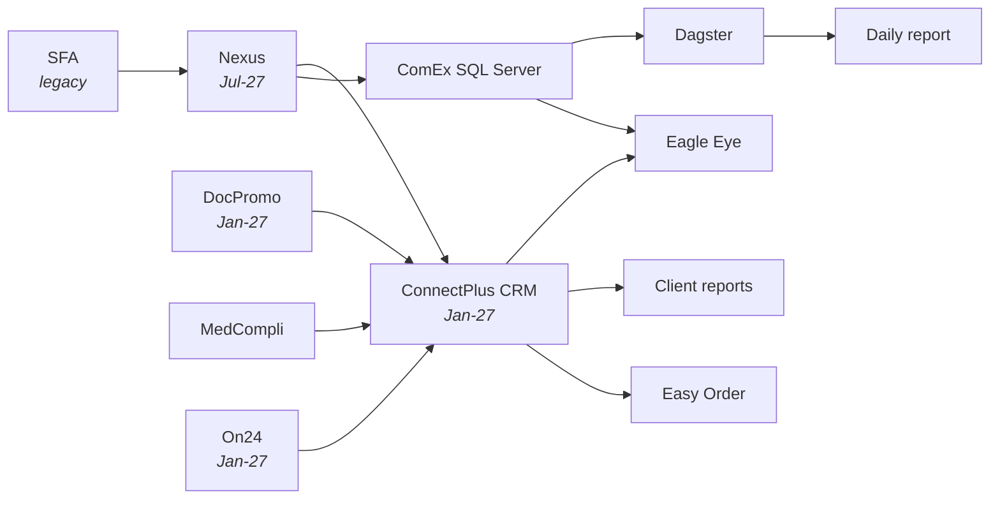

# ComEx App Ecosystem

Shape of the ecosystem: **sources → CRM hub → consumers**.

## Sources

| App | State | Purpose |
|---|---|---|
| **SFA** | Legacy platform | Mapping customers; sales tracking for specific teams only |
| **DocPromo** | Expecting Jan-27 | Promotional material approving |
| **MedCompli** | Live | Speaker fee approving; event fee approving; sponsorship for HCO |
| **On24** | Expecting Jan-27 | Webinar platform |

## Hub

| App | State | Purpose |
|---|---|---|
| **Nexus** | Expecting Jul-27 | Sales Rep master data management. Works in parallel with ComEx SQL Server |
| **ConnectPlus (CRM)** | Expecting Jan-27 | Managing all sales activities. Central hub |
| **ComEx SQL Server** | Live | Master data management. Works in parallel with Nexus |

## Consumers

| App | State | Purpose |
|---|---|---|
| **Dagster** | Live — automation platform | Territory mapping |
| **Eagle Eye** | Live | Sales monitoring; KPIs monitoring |
| **Client reports** | Live — *managed by AIS team* | Sales monitoring at client level |
| **Easy Order** | Live | Ordering platform |
| **Daily report** | Live | Sends mapped data to sales |

> Source: *ComEx App Ecosystem | Future*, page 2.
